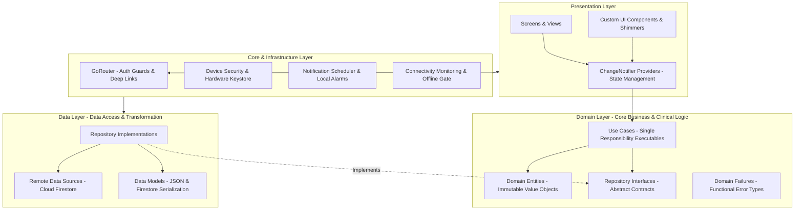

# 🏛️ System Architecture & Engineering Specification
## Smart Medication Management System for Elderly People (Medical Care App)
### Architectural Blueprint, Design Patterns, and Enterprise Standards

---

## 📌 1. Architectural Philosophy & Overview

The **Smart Medication Management System** is engineered using **Clean Architecture** principles combined with a **Feature-First Modular Structure**. Designed to enterprise standards practiced at technology leaders such as Google and Meta, the system enforces a strict **Separation of Concerns (SoC)**, decoupling core business rules and clinical domain logic from any framework, UI framework, or cloud backend.



---

## 📂 2. Directory Tree & Structural Organization

The repository source directory (`lib/`) is structured as follows:

```
lib/
├── core/                               # Cross-cutting concerns & foundational infrastructure
│   ├── config/                         # Routing & app configuration
│   │   └── app_router.dart             # GoRouter setup, authentication guards & redirect logic
│   ├── errors/                         # Universal error modeling
│   │   └── failures.dart               # Domain failure hierarchy (Auth, Network, Server, Cache)
│   ├── services/                       # Low-level platform & hardware services
│   │   ├── connectivity_service.dart   # Real-time network telemetry via streams
│   │   ├── credentials_manager.dart    # Hardware Keystore / Keychain secure storage
│   │   ├── device_security_service.dart# Root / Jailbreak & compromised environment detection
│   │   ├── doctor_patient_service.dart # Cross-role relationship binding
│   │   ├── local_notification_service.dart # System alarm & interactive notification channels
│   │   ├── medicine_reminder_service.dart  # Dosage alarm lifecycle coordinator
│   │   ├── notification_action_handler.dart# Pending action queue & cold-start replay stream
│   │   └── notification_scheduler.dart # Deterministic notification ID hash generation
│   ├── utils/                          # Responsiveness & typography scaling
│   │   └── responsive_utils.dart       # Breakpoints, clamped font scaling, touch targets
│   ├── validators/                     # Input validation & sanitization
│   │   └── auth_validators.dart        # Regex validation for Arabic/English names, emails, credentials
│   ├── widgets/                        # Core UI components
│   │   ├── offline_auth_gate.dart      # 7-day offline grace period validator
│   │   ├── offline_banner.dart         # Persistent animated connection status bar
│   │   ├── responsive_card.dart        # Geriatric-optimized card with soft elevation
│   │   └── sync_status_widget.dart     # Cloud synchronization state indicator
│   ├── app_colors.dart                 # Clinical color palette (Normal, Borderline, Critical)
│   ├── app_constants.dart              # Global constants, collection names, timeouts
│   ├── app_shadows.dart                # Soft elevation and depth system
│   ├── app_text_styles.dart            # WCAG 2.1 compliant typography tokens
│   ├── app_theme.dart                  # Material 3 light and dark theme configurations
│   └── design_tokens.dart              # Clamped spacing, minimum button sizes (48-56dp)
│
├── features/                           # Feature-first modular business domains
│   ├── auth/                           # Authentication, registration & verification
│   │   └── presentation/               # Screens (Login, Register, Welcome, Email Verification)
│   ├── doctor_dashboard/               # Healthcare provider CRM & clinical analytics
│   │   └── presentation/               # Patient CRM, KPIs, critical alert feeds, adherence ring
│   ├── health_readings/                # Vital signs tracking & physiological analytics
│   │   ├── controllers/                # Reading controllers with rate-limiting
│   │   ├── screens/                    # Reading history, entry form, live trend charts
│   │   ├── utils/                      # Clinical statistics calculators & rate limiters
│   │   └── widgets/                    # AHA/ADA evaluation cards, interactive charts
│   ├── home/                           # Patient central dashboard
│   │   ├── data/                       # Home aggregator repository
│   │   ├── domain/                     # Composite health scoring engine & evaluation models
│   │   └── presentation/               # Patient home screen, today's schedule, daily tips
│   ├── medicines/                      # Core medication management (Full Clean Architecture)
│   │   ├── data/                       # Data sources, models, repository implementation
│   │   ├── domain/                     # Entities, use cases, repository contracts, failures
│   │   └── presentation/               # Medicine catalog, addition forms, dosage sheets
│   ├── navigation/                     # Primary application navigation shell
│   │   └── screens/                    # Main bottom navigation bar with enlarged touch targets
│   ├── notifications/                  # In-app notification center & history
│   │   ├── data/ & domain/             # Notification entities & chronological grouping
│   │   └── presentation/               # Notification feeds with swipe-to-dismiss actions
│   └── profile/                        # User demographics, medical history & pairing
│       └── presentation/               # Profile management, password reset, patient QR code
│
├── l10n/                               # Localization & multi-language engine
│   ├── app_ar.arb                      # Arabic translation strings (RTL native)
│   ├── app_en.arb                      # English translation strings (LTR native)
│   └── app_localizations.dart          # Compile-time type-safe localization delegate
│
├── models/                             # Shared legacy models & medical value objects
│   ├── health/                         # Health reading, reading types, reading status models
│   ├── medicine.dart                   # Medication data models
│   └── user_model.dart                 # Patient & Doctor user profiles
│
├── providers/                          # Global state management
│   ├── auth_provider.dart              # Authentication state machine & user session
│   └── settings_provider.dart          # Locale (AR/EN) & ThemeMode (Light/Dark)
│
├── services/                           # Shared services
│   ├── auth/                           # Security, progressive lockout, device fingerprinting
│   ├── auth_service.dart               # Firebase Auth wrapper
│   └── notification_service.dart       # Firebase Cloud Messaging (FCM) integration
│
├── app.dart                            # Application root, lifecycle observer & global snackbars
└── main.dart                           # Entry point, sequential initialization & error zones
```

---

## ⚙️ 3. Design Patterns Applied

### 1. Repository Pattern
Abstracts the data persistence layer from business use cases. The domain layer specifies an abstract interface (e.g., [`MedicinesRepository`](file:///d:/VIP/مشروع%20التخرج/develop/lib/features/medicines/domain/repositories/medicines_repository.dart)), while the data layer provides the concrete implementation ([`MedicinesRepositoryImpl`](file:///d:/VIP/مشروع%20التخرج/develop/lib/features/medicines/data/repositories/medicines_repository_impl.dart)) that coordinates between Firestore and local caches.

### 2. Use Case (Interactor) Pattern
Every business action is encapsulated in a dedicated, single-responsibility class implementing an `execute()` or `call()` method:
- `AddMedicineUseCase`: Validates parameters and triggers scheduling upon creation.
- `TakeDoseUseCase`: Records consumption timestamp, decrements stock count, and updates adherence metrics.
- `GetAdherenceSummaryUseCase`: Calculates period-specific compliance rates.

### 3. Functional Error Handling (`Either<Failure, T>`)
Instead of throwing uncaught runtime exceptions across layers, all use cases return `Either<Failure, T>` from the `dartz` package. This forces explicit compile-time handling of both success and failure states in UI providers.

### 4. Observer Pattern & Reactive Streams
- `Firestore Snapshots`: Real-time bi-directional streaming between patient data and doctor dashboard.
- `ConnectivityService`: Emits connection status changes to keep the UI in sync.
- `ChangeNotifier`: Providers notify listeners upon mutation, triggering granular widget rebuilds.

### 5. Replay Subject & Pending Action Queue Pattern
Solves the mobile **Cold Start Race Condition**: when a patient taps an interactive notification button (e.g., "Mark as Taken") while the app process is terminated, [`NotificationActionHandler`](file:///d:/VIP/مشروع%20التخرج/develop/lib/core/services/notification_action_handler.dart) captures the action in an internal pending queue and replays it through a broadcast stream as soon as the widget tree is mounted.

---

## 🧮 4. Mathematical Models & Core Algorithms

### Algorithm 1: Progressive Lockout (Brute-Force Mitigation)
Implements an exponential penalty ladder based on consecutive failed authentication attempts ($A$):

$$\text{Lockout Duration}(A) = \begin{cases} 
0 & \text{if } A < 3 \\
1 \text{ min} & \text{if } 3 \le A < 5 \\
5 \text{ mins} & \text{if } 5 \le A < 8 \\
15 \text{ mins} & \text{if } 8 \le A < 12 \\
30 \text{ mins} & \text{if } 12 \le A < 15 \\
\infty \text{ (Permanent Lock)} & \text{if } A \ge 15 
\end{cases}$$

State is persisted in Firestore (`login_attempts/{email}`) with server timestamps, resilient to client-side clock tampering.

### Algorithm 2: Deterministic Notification ID Hashing
To prevent notification identifier collisions across medicines and time slots:

$$\text{ID} = 100{,}000 + \Big( \big| \text{Hash}(\text{MedicineID}) \big| \pmod{10{,}000} \Big) \times 10 + \text{TimeSlotIndex}$$

This enables deterministic cancellation and rescheduling without requiring persistent storage of arbitrary ID arrays.

### Algorithm 3: Composite Health Scoring & BMI Engine
Calculates an aggregate health vitality score ($S \in [0, 100]$):

$$S = \max\Big(0, \, 100 - \big( P_{\text{BP}} + P_{\text{Glucose}} + P_{\text{Weight}} \big)\Big)$$

Where penalties are assigned based on clinical guidelines:
- $P_{\text{BP}} \in \{0, 12, 25, 35\}$ based on AHA classification.
- $P_{\text{Glucose}} \in \{0, 12, 25, 35\}$ based on ADA fasting/postprandial thresholds.
- $P_{\text{Weight}} \in \{0, 8, 20\}$ derived from Body Mass Index:
  $$\text{BMI} = \frac{\text{Weight (kg)}}{\left(\frac{\text{Height (cm)}}{100}\right)^2}$$

### Algorithm 4: Action Idempotency via Sliding TTL Window
To prevent double-logging or duplicate inventory decrements when interactive notification buttons are pressed repeatedly:

$$\text{ActionHash} = \text{SHA-256}(\text{MedicineID} \parallel \text{ActionType} \parallel \text{ScheduledSlot})$$

Actions matching an existing key in the active 5-minute memory cache are suppressed.

---

## 🔒 5. Enterprise Security Architecture

1. **Hardware-Backed Cryptographic Storage:**
   Credentials and authentication tokens are encrypted via AES-256 using the **Android Keystore** and **iOS Keychain Services** (`flutter_secure_storage`).
2. **Environment & Integrity Telemetry:**
   [`DeviceSecurityService`](file:///d:/VIP/مشروع%20التخرج/develop/lib/core/services/device_security_service.dart) performs heuristic analysis for rooted/jailbroken environments (checking 9 binary paths, Magisk packages, and test-keys build tags). In compromised environments, persistent offline caching is automatically disabled.
3. **Zero-Trust Cloud Security Rules:**
   - 342 lines of declarative Firestore rules enforce strict Role-Based Access Control (RBAC).
   - Relationship authorization verifies linked doctor-patient pairing (`doctor_patients/{doctorId_patientId}`).
   - Audit logs (`security_logs`) are immutable (`allow update, delete: false`).
   - Strict size and regex validations run on all mutation operations.

---

## 📶 6. Offline-First Resilience & Fault Tolerance

```
[Network Status] ──> Online  ──> Firestore Cloud Sync ──> Persistent 100MB Cache
                 └──> Offline ──> OfflineAuthGate Validates ──> 7-Day Grace Period
                                └──> Local Notifications Fire via Timezone Engine
                                └──> Changes Queued Locally ──> Auto-Sync on Reconnect
```

- **Firestore Local Persistence:** Configured with a dedicated 100 MB disk cache.
- **7-Day Offline Grace Period:** Patients can open the app, inspect schedules, and take doses during network outages without being logged out.
- **Crashlytics Pipeline:** All uncaught platform errors and Dart exceptions are piped through `runZonedGuarded` and reported in production.

---

**Authored by Shehab Hassan & Project Team • Class of 2026**
