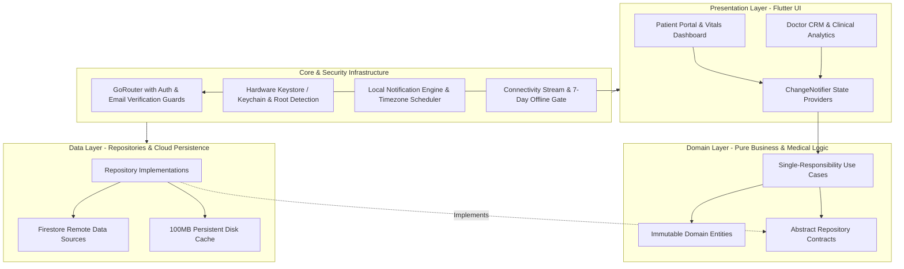

# 🏥 Smart Medication Management System for Elderly People
### An Enterprise-Grade Cloud Telehealth & Medication Adherence Platform

[](https://flutter.dev)
[](https://dart.dev)
[](ARCHITECTURE.md)
[](https://firebase.google.com)
[]()
[](ARCHITECTURE.md#5-enterprise-security-architecture)
[](LICENSE)
[](docs/COMPREHENSIVE_ANALYSIS.md)

---

## 📖 Executive Summary & Mission

Elderly patients suffering from chronic illnesses (hypertension, diabetes, cardiovascular conditions) frequently encounter **polypharmacy challenges**—managing multiple medications with differing doses, schedules, and dietary conditions. According to global health statistics, over **50% of medication non-adherence** leads to preventable clinical deterioration, emergency readmissions, and fatal drug complications.

**Medical Care App** is an enterprise-grade mobile health (mHealth) platform engineered to solve this crisis. Grounded in modern software engineering principles from tech giants (Google & Meta) and clinical guidelines from the **American Heart Association (AHA)** and the **American Diabetes Association (ADA)**, the system bridges the gap between elderly patients and their physicians through:

1. **Intelligent, non-intrusive interactive medication reminders** that operate seamlessly even during network outages and device restarts.
2. **Clinical vital signs tracking** with automated, color-coded health risk evaluations and composite vitality scoring.
3. **A dedicated Healthcare Provider CRM (Doctor Dashboard)** enabling real-time remote telemetry, patient adherence ranking, and critical health alert notifications.
4. **Instant cryptographic QR code pairing** between doctor and patient in the clinic without manual configuration.

---

## 🏛️ System Architecture

The application strictly implements **Clean Architecture** combined with a **Feature-First Modular Structure** to ensure complete decoupling of business rules from external frameworks, databases, and UI components.



Detailed architectural blueprints, design patterns, and module interactions are documented in **[ARCHITECTURE.md](ARCHITECTURE.md)**.

---

## ✨ Key Features & User Journeys

### 👴 1. For Elderly Patients & Caregivers
- **Interactive Notification Action Buttons:** Patients can confirm doses directly from lock screen notifications (**Taken** ✅ / **Skip** ⏭️ / **Snooze** ⏰) without opening the app.
- **30-Minute Grace Period State Machine:** Automatically distinguishes between *Upcoming*, *Due*, *In Grace Period*, and *Overdue* doses, reassuring patients who take medicines slightly after the target time.
- **Comprehensive Vitals Tracking:** Track blood pressure (systolic/diastolic/pulse pressure), blood glucose (fasting vs. postprandial), body weight, and temperature.
- **Composite Health Score ($0 - 100$):** An intelligent vitality score based on clinical penalties, accompanied by plain-language actionable medical advice.
- **Geriatric Accessibility (WCAG 2.1 AA/AAA):** Extra-large touch targets ($\ge 48-56\text{dp}$), high visual contrast, and clamped dynamic typography scaling to prevent UI clipping when phone system font sizes are enlarged.
- **QR Patient Passport:** Generates a secure, cryptographically hashed QR code for instant clinic pairing.

### 🩺 2. For Doctors & Healthcare Providers
- **Patient Relationship Management (CRM):** Centralized directory of all assigned patients with real-time compliance badges.
- **Live Vital Signs Telemetry:** Real-time data streams tracking patient glucose and blood pressure fluctuations over 7, 30, and 90-day periods.
- **Critical Alert Dispatcher:** Immediate automated notifications when a patient records alarming readings (e.g., Blood Pressure $\ge 180/120\text{ mmHg}$ or Blood Sugar $< 54\text{ mg/dL}$).
- **Adherence Ranking & Analytics:** Mathematical scoring classifying patients into *High Adherence* ($\ge 85\%$), *Moderate* ($70-84\%$), or *Critical* ($< 70\%$).
- **Built-in Optical QR Scanner:** Doctors scan the patient's device screen to instantly establish access permissions.

---

## 🧮 Mathematical Models & Core Algorithms

| Algorithm | Formula / Mechanism | Practical Benefit |
| :--- | :--- | :--- |
| **Progressive Lockout** | $\text{Lockout}(A) \in \{0, 1\text{m}, 5\text{m}, 15\text{m}, 30\text{m}, \infty\}$ | Eliminates brute-force attacks by exponentially penalizing repeated failures. |
| **Deterministic Notification Hash** | $\text{ID} = 100{,}000 + (|\text{Hash}(\text{ID})| \bmod 10{,}000) \times 10 + \text{Slot}$ | Guarantees non-colliding notification IDs across medicines without persistent ID databases. |
| **Adherence Rate Engine** | $R_{\text{adherence}} = \frac{\sum \mathbb{I}(\text{taken})}{\sum \mathbb{I}(\text{scheduled})} \times 100$ | Objective statistical metric for treatment compliance. |
| **Composite Health Scoring** | $S = \max(0, 100 - (P_{\text{BP}} + P_{\text{Glucose}} + P_{\text{BMI}}))$ | Translates complex multi-vital medical data into a single intuitive metric for seniors. |
| **Action Idempotency Cache** | $\text{Hash} = \text{SHA-256}(\text{MedID} \parallel \text{Action} \parallel \text{Timestamp})$ | Prevents duplicate stock deductions and duplicate dose logs during repeated button taps. |

---

## 🔒 Enterprise Security & Threat Mitigation

- **Hardware-Backed Encryption:** Sensitive credentials and session tokens are encrypted via AES-256 in **Android Keystore** and **iOS Keychain Services** (`flutter_secure_storage`).
- **Device Integrity Verification:** Heuristic root & jailbreak detection inspects 9 binary locations, Magisk signatures, and test-keys build tags via [`DeviceSecurityService`](lib/core/services/device_security_service.dart), automatically disabling local offline caching on compromised hardware.
- **Zero-Trust Cloud Rules:** 342 lines of declarative [Firestore Security Rules](firestore.rules) enforcing strict Role-Based Access Control (RBAC), relational verification (`doctor_patients`), field-level type validation, and immutable audit logs (`security_logs`).
- **Cold-Start Action Queue:** Resolves notification clicks while the app is killed using a `ReplaySubject` stream and pending action queue.

---

## 📶 Offline-First Resilience

- **100MB Persistent Disk Cache:** Firebase Firestore is configured with a persistent cache enabling full browsing and dose logging in remote or network-deprived areas.
- **7-Day Offline Authentication Gate:** Allows verified users with "Remember Me" enabled to retain full access for 7 days without connectivity.
- **Real-Time Telemetry & Auto-Sync:** Live connection banner alerts users during disconnections and triggers automatic bi-directional sync upon reconnection.
- **Crashlytics Pipeline:** Uncaught asynchronous exceptions are trapped via `runZonedGuarded` and sent to Firebase Crashlytics in production.

---

## 🛠️ Technology Stack Matrix

```
┌────────────────────────────────────────────────────────────────────────┐
│                        TECHNOLOGY STACK MATRIX                         │
├────────────────────────┬─────────────────────┬─────────────────────────┤
│ Domain Layer           │ Technology / Tool   │ Purpose                 │
├────────────────────────┼─────────────────────┼─────────────────────────┤
│ Framework & Language   │ Flutter 3.x / Dart  │ Cross-platform core     │
│ Architecture           │ Clean Architecture  │ SoC & Maintainability   │
│ State Management       │ Provider (v6.1.2)   │ Reactive state control  │
│ Routing                │ GoRouter (v14.6.2)  │ Declarative auth guards │
│ Backend & Cloud        │ Firebase Firestore  │ Real-time cloud NoSQL   │
│ Authentication         │ Firebase Auth       │ Secure user sessions    │
│ Cryptography           │ Keystore / Keychain │ AES-256 credential safe │
│ Local Alarms           │ Local Notifications │ Accurate alarm manager  │
│ Push Notifications     │ Firebase Cloud Msg  │ Telehealth alerts (FCM) │
│ Medical Charts         │ fl_chart (v0.68.0)  │ Physiological analytics │
│ Optical Scanning       │ mobile_scanner & QR │ Rapid clinic pairing    │
│ Internationalization   │ Flutter L10n / Intl │ Arabic (RTL) & English  │
│ Telemetry & Crashlytics│ Firebase Crashlytics│ Production stability    │
└────────────────────────┴─────────────────────┴─────────────────────────┘
```

---

## 🚀 Quick Start & Installation

### Prerequisites
- [Flutter SDK](https://docs.flutter.dev/get-started/install) (`>= 3.22.0`)
- [Dart SDK](https://dart.dev/get-dart) (`>= 3.0.0`)
- Android Studio / Xcode
- A configured [Firebase Project](https://firebase.google.com) with Firestore & Authentication enabled.

### Step-by-Step Setup

1. **Clone the repository:**
   ```bash
   git clone https://github.com/shehabhassanpro-stack/smart-medication-management-system.git
   cd smart-medication-management-system
   ```

2. **Install project dependencies:**
   ```bash
   flutter pub get
   ```

3. **Generate localization files:**
   ```bash
   flutter gen-l10n
   ```

4. **Verify static analysis:**
   ```bash
   flutter analyze
   ```

5. **Run the application:**
   ```bash
   # Debug mode on connected physical device or emulator
   flutter run
   ```

6. **Build production APK / App Bundle:**
   ```bash
   flutter build apk --release
   ```

---

## 🎓 Academic Credentials & Project Attribution

This project was developed in partial fulfillment of the requirements for the **Degree of Bachelor of Computer Science and Information Systems** (Class of 2026).

- **Institution:** Ministry of High Education — Culture and Science City at Oct 6 — The High Institute of Computer Science & Information Systems
- **Project Title:** Smart Medication Management System for Elderly People
- **Project Code:** F26_504
- **Academic Year:** 2025 / 2026
- **Supervisors:**
  - **Dr. Eng. Omaima Goher** (Project Supervisor)
  - **TA. Menna Magdy** (Assistant Supervisor)

### 👨‍💻 Engineering Team:
1. **Shehab Hassan Ahmed Abdelhaleem** — *Team Lead & Core Software Engineer* (ID: 221256)
2. **Ahmed Mohamed Fathy Hassan Seddik** (ID: 212417)
3. **Abdelrahman Hassan Fathy Hassan** (ID: 223274)
4. **Seif Eldin Ashraf Saeed Abdelkhalek** (ID: 222462)
5. **Shehab Mostafa Mortada Abdo** (ID: 222678)
6. **Abdelhameed Abdelhaleem Abdelhameed Mohamed** (ID: 222312)
7. **Abdelrahman Mohamed Saeed Abdelaziz** (ID: 223412)

---

## 📚 In-Depth Technical Documentation

For in-depth architectural and scientific reading, consult the documentation in [`docs/`](docs/):
- **[System Architecture & Design Patterns Specification](ARCHITECTURE.md)**: Deep dive into Clean Architecture layers, algorithms, and design patterns.
- **[Comprehensive Technical & Scientific Evaluation](docs/COMPREHENSIVE_ANALYSIS.md)**: Exhaustive 10-section analysis of all 166 code modules, security proofs, and clinical equations.
- **[Executive Summary & Field Guide](docs/EXECUTIVE_SUMMARY.md)**: Condensed product overview and value proposition.
- **[Official Graduation Project Thesis (PDF)](docs/Smart_Medication_Management_System_Elderly_People.pdf)**: Complete 79-page formal academic report.

---

## 📄 License

This project is licensed under the **MIT License** — see the [LICENSE](LICENSE) file for details.
