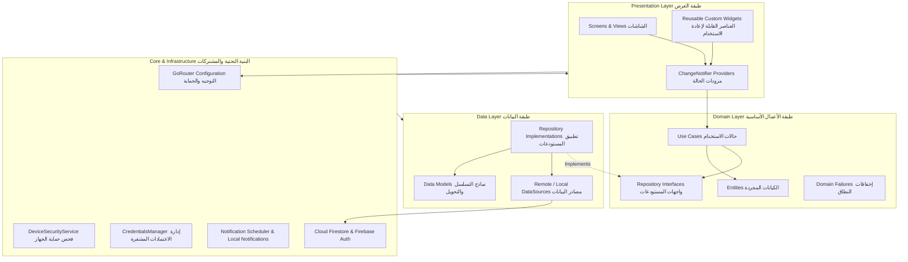
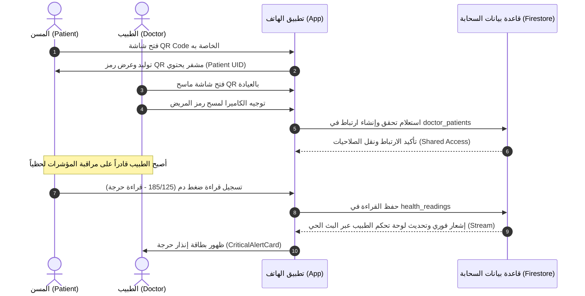

# 🏥 التقرير الهندسي الشامل: نظام إدارة الأدوية الذكي والمتابعة الصحية لكبار السن
## Smart Medication Management System for Elderly People (Medical Care App)
### وثيقة الفحص والتحليل البرمجي الشامل طبقاً للمعايير العلمية والهندسية للشركات التقنية الكبرى (Google & Meta Standards)

---

## 📋 معلومات المشروع الأكاديمية (Academic Metadata)

- **اسم المشروع:** Smart Medication Management System for Elderly People (Medical Care App)
- **المؤسسة الأكاديمية:** وزارة التعليم العالي - مدينة الثقافة والعلوم بالسادس من أكتوبر - المعهد العالي لعلوم الحاسب ونظم المعلومات
- **الدرجة العلمية:** بكالوريوس في علوم الحاسب ونظم المعلومات (Bachelor of Computer Science and Information Systems)
- **العام الأكاديمي:** 2025 / 2026
- **رقم المشروع:** F26_504
- **إشراف:** 
  - **أ.د.م / أميمة جوهر** (Dr. Eng. Omaima Goher)
  - **م.م / منة مجدي** (TA. Menna Magdy)
- **فريق العمل (Student Engineers):**
  1. شهاب حسن أحمد عبد الحليم (ID: 221256)
  2. أحمد محمد فتحي حسن صديق (ID: 212417)
  3. عبد الرحمن حسن فتحي حسن (ID: 223274)
  4. سيف الدين أشرف سعيد عبد السميع (ID: 222462)
  5. شهاب مصطفى مرتضى عبده (ID: 222678)
  6. عبد الحميد عبد الحليم عبد الحميد محمد (ID: 222312)
  7. عبد الرحمن محمد سعيد عبد العزيز (ID: 223412)

---

## 📑 فهرس المحتويات (Table of Contents)

1. [مقدمة تقنية وتقييم المعايير الهندسية (Engineering Overview & Big Tech Benchmarking)](#1-مقدمة-تقنية-وتقييم-المعايير-الهندسية)
2. [الهيكل المعماري للنظام (Clean Architecture & Structural Design)](#2-الهيكل-المعماري-للنظام)
3. [الفحص الشامل لملفات المشروع وعلاقاتها التبادلية (Exhaustive File & Dependency Inventory)](#3-الفحص-الشامل-لملفات-المشروع-وعلاقاتها-التبادلية)
4. [الخوارزميات والنماذج الرياضية المستخدمة (Algorithms & Mathematical Formulations)](#4-الخوارزميات-والنماذج-الرياضية-المستخدمة)
5. [بنية الأمان وحماية البيانات (Enterprise Security & Threat Mitigation)](#5-بنية-الأمان-وحماية-البيانات)
6. [المعايير السريرية والطبية المعتمدة (Clinical & Medical Standards)](#6-المعايير-السريرية-والطبية-المعتمدة)
7. [معايير تجربة وواجهة المستخدم لكبار السن (Geriatric UI/UX & Accessibility)](#7-معايير-تجربة-وواجهة-المستخدم-لكبار-السن)
8. [منظومة الطبيب والمريض والتزامن الحي (Doctor-Patient Ecosystem & Synchronization)](#8-منظومة-الطبيب-والمريض-والتزامن-الحي)
9. [استراتيجية العمل دون إنترنت ومعالجة الأخطاء (Offline Resilience & Fault Tolerance)](#9-استراتيجية-العمل-دون-إنترنت-ومعالجة-الأخطاء)
10. [تقييم الجودة والتوصيات المستقبلية (Quality Assessment, Debt & Roadmap)](#10-تقييم-الجودة-والتوصيات-المستقبلية)

---

## 1. مقدمة تقنية وتقييم المعايير الهندسية
### Engineering Overview & Big Tech Benchmarking

يمثل تطبيق **Medical Care App** نظاماً متكاملاً لإدارة الرعاية الصحية والأدوية مصمماً خصيصاً للتغلب على إشكاليات عدم الالتزام الدوائي (Medication Non-Adherence) لدى كبار السن ومرضى الأمراض المزمنة، مع توفير بوابة متخصصة للأطباء (Doctor CRM) لمتابعة المؤشرات الحيوية ونسب الالتزام لحظياً.

### 📊 إحصائيات الكود البرمجي الممسوح (Static Code Analysis Metrics):
- **إجمالي ملفات دارت (Dart Files):** 166 ملفاً في حزمة `lib/`
- **إجمالي سطور الكود (LOC):** ما يزيد عن **69,800 سطر برمجي**
- **قواعد أمان قاعدة البيانات (Firestore Security Rules):** 342 سطراً فائق الدقة (Zero-Trust RBAC)
- **منظومة الترجمة ودعم اللغات (Localization):** دعم كامل للغتين العربية والإنجليزية (RTL / LTR) عبر 3,569 سطراً برمجياً
- **النمط المعماري المعتمد:** Clean Architecture + Feature-First Modular Structure
- **نمط إدارة الحالة (State Management):** Provider / ChangeNotifier مع فصل تام للمنطق التجاري (Business Logic Separation)
- **منظومة التوجيه (Routing):** GoRouter مع Guard Routes و Deep-Linking

### 🏢 المقارنة بمعايير كبار شركات التقنية (Google & Meta Engineering Standards):
1. **فصل الاهتمامات (Separation of Concerns - SoC):** فصل طبقات العرض عن المنطق التجاري وطبقة البيانات، مما يضمن قابلية الاختبار (Testability) وقابلية الصيانة (Maintainability).
2. **برمجة آمنة ودفاعية (Defensive Programming):** التحقق من صحة كافة المدخلات من جانب العميل وقواعد السحابة، مع تدقيق أمني للأجهزة المخترقة (Root/Jailbreak Detection).
3. **تصميم مرن دون اتصال (Offline-First Design):** دعم التخزين المؤقت المستمر (Persistent 100MB Firestore Cache) مع فترة سماح للمصادقة في وضع عدم الاتصال (7-Day Offline Grace Period).
4. **توجيه موثوق للأحداث غير المتزامنة (Event Idempotency & Replay):** معالجة تفاعلات الإشعارات عبر طابور انتظار (Pending Actions Queue) وقمع التكرارات (Deduplication via TTL Cache).

---

## 2. الهيكل المعماري للنظام
### Clean Architecture & Structural Design

يتبنى المشروع مبادئ **الهندسة النظيفة (Clean Architecture)** مقترنة بالتنظيم القائم على الميزات (**Feature-First Modular Architecture**). هذا النهج يضمن استقلالية المنطق التجاري عن أي أطر خارجية أو قواعد بيانات، وفق الشكل التوضيحي التالي:



### تفصيل الطبقات المعمارية (Architectural Layers):

1. **طبقة النطاق (Domain Layer):**
   - **الكيانات (Entities):** كائنات غير قابلة للتعديل (`@immutable`) مثل [`MedicineEntity`](file:///d:/VIP/مشروع%20التخرج/develop/lib/features/medicines/domain/entities/medicine_entity.dart) و [`DoseLogEntity`](file:///d:/VIP/مشروع%20التخرج/develop/lib/features/medicines/domain/entities/medicine_entity.dart).
   - **عقود المستودعات (Repository Interfaces):** واجهات مجردة مثل [`MedicinesRepository`](file:///d:/VIP/مشروع%20التخرج/develop/lib/features/medicines/domain/repositories/medicines_repository.dart).
   - **حالات الاستخدام (Use Cases):** أصناف تنفذ إجراءً واحداً محدداً (Single Responsibility) مثل [`AddMedicineUseCase`](file:///d:/VIP/مشروع%20التخرج/develop/lib/features/medicines/domain/usecases/add_medicine_usecase.dart)، [`GetMedicinesUseCase`](file:///d:/VIP/مشروع%20التخرج/develop/lib/features/medicines/domain/usecases/get_medicines_usecase.dart)، وتستخدم مكتبة `dartz` لنمط البرمجة الوظيفية `Either<Failure, T>` لضمان معالجة الأخطاء دون انهيار التطبيق.

2. **طبقة البيانات (Data Layer):**
   - **النماذج (Models):** مثل [`MedicineModel`](file:///d:/VIP/مشروع%20التخرج/develop/lib/features/medicines/data/models/medicine_model.dart) الذي يرث من `MedicineEntity` ويضيف دوال `toFirestore()` و `fromFirestore()`.
   - **مصادر البيانات (Data Sources):** مثل [`MedicinesRemoteDataSource`](file:///d:/VIP/مشروع%20التخرج/develop/lib/features/medicines/data/datasources/medicines_remote_datasource.dart) للتعامل المباشر مع مجموعات Firestore.
   - **تطبيق المستودعات (Repository Implementations):** مثل [`MedicinesRepositoryImpl`](file:///d:/VIP/مشروع%20التخرج/develop/lib/features/medicines/data/repositories/medicines_repository_impl.dart) لترجمة الاستثناءات التقنية إلى `MedicineFailure` معالجة.

3. **طبقة العرض (Presentation Layer):**
   - **مزودات الحالة (Providers):** مثل [`MedicinesProvider`](file:///d:/VIP/مشروع%20التخرج/develop/lib/features/medicines/presentation/providers/medicines_provider.dart) و [`HomeProvider`](file:///d:/VIP/مشروع%20التخرج/develop/lib/features/home/presentation/providers/home_provider.dart) و [`DoctorReportsProvider`](file:///d:/VIP/مشروع%20التخرج/develop/lib/features/doctor_dashboard/presentation/providers/doctor_reports_provider.dart).
   - **الشاشات والواجهات (Screens & Widgets):** تصميم واجهات رعاية تركز على كبار السن مع عناصر بصرية متوافقة مع معايير الوصول (Accessibility).

4. **طبقة المشتركات والخدمات المركزية (Core & Services Layer):**
   - خدمات التشفير وإدارة الجلسات ومراقبة الشبكة وجدولة التنبيهات واكتشاف كسر الحماية (Jailbreak/Root).

---

## 3. الفحص الشامل لملفات المشروع وعلاقاتها التبادلية
### Exhaustive File & Dependency Inventory

تم مسح وقراءة كافة الملفات البالغ عددها 166 ملفاً في مجلد `develop/lib/`. وفيما يلي بيان تفصيلي منظم وفق الوحدات الوظيفية (Modules):

### 1. مجلد النواة والمشتركات: `develop/lib/core/` (24 ملفاً - 12,023 سطراً)
| اسم الملف | الوظيفة الهندسية ومحتوى الكود | العلاقات والاعتمادات |
| :--- | :--- | :--- |
| [`app_colors.dart`](file:///d:/VIP/مشروع%20التخرج/develop/lib/core/app_colors.dart) | لوحة الألوان الطبية القياسية، تدرجات الحالة الصحية (طبيعي، حدّي، خطر)، ألوان الوضع المظلم والفاتح. | مستخدم في كافة شاشات وعناصر التطبيق |
| [`app_config.dart`](file:///d:/VIP/مشروع%20التخرج/develop/lib/core/app_config.dart) | إعدادات البيئة العامة للتطبيق وإصدار المنظومة. | ملف تهيئة أولي |
| [`app_constants.dart`](file:///d:/VIP/مشروع%20التخرج/develop/lib/core/app_constants.dart) | ثوابت التطبيق: مفاتيح Firestore، أوقات انتهاء الجلسات، أحجام الملفات والقيود. | مستخدم عبر طبقات البيانات والخدمات |
| [`app_shadows.dart`](file:///d:/VIP/مشروع%20التخرج/develop/lib/core/app_shadows.dart) | منظومة الظلال الناعمة لبطاقات كبار السن لتوفير عمق بصري (Neumorphism-like depth). | مستخدم في البطاقات والمربعات الحوارية |
| [`app_text_styles.dart`](file:///d:/VIP/مشروع%20التخرج/develop/lib/core/app_text_styles.dart) | أنماط الخطوط والطباعة مع مراعاة أحجام القراءة المريحة لكبار السن. | مستخدم في كافة عناصر النصوص |
| [`app_theme.dart`](file:///d:/VIP/مشروع%20التخرج/develop/lib/core/app_theme.dart) | تكوين الثيم الكامل (Light & Dark Themes) وضبط ألوان المكونات والأزرار وشريط التطبيق. | يربط في `app.dart` عبر `MaterialApp.router` |
| [`design_tokens.dart`](file:///d:/VIP/مشروع%20التخرج/develop/lib/core/design_tokens.dart) | وحدات التصميم القياسية: المسافات، أنصاف الأقطار، حجوم الأزرار القياسية المقيدة. | يعتمد على `ResponsiveUtils` لتكييف الأبعاد |
| [`config/app_router.dart`](file:///d:/VIP/مشروع%20التخرج/develop/lib/core/config/app_router.dart) | محرك التوجيه الشامل عبر `GoRouter` مع بوابات الحماية للتحقق من المصادقة وتوثيق البريد. | يعتمد على `AuthProvider` ومسارات جميع الشاشات |
| [`errors/failures.dart`](file:///d:/VIP/مشروع%20التخرج/develop/lib/core/errors/failures.dart) | التسلسل الهرمي للإخفاقات (`AuthFailure`, `NetworkFailure`, `TimeoutFailure`, `ServerFailure`). | مستخدم في منطق العمل والمستودعات |
| [`services/connectivity_service.dart`](file:///d:/VIP/مشروع%20التخرج/develop/lib/core/services/connectivity_service.dart) | مراقب الاتصال بالإنترنت لحظياً عبر `connectivity_plus` وتوفير Stream للحالة. | يستهلكه `OfflineBanner` و `OfflineAuthGate` |
| [`services/credentials_manager.dart`](file:///d:/VIP/مشروع%20التخرج/develop/lib/core/services/credentials_manager.dart) | إدارة الاعتمادات المشفرة عبر `FlutterSecureStorage` واستخدام Android Keystore و iOS Keychain. | يعتمد عليه `AuthProvider` و `LoginForm` |
| [`services/device_security_service.dart`](file:///d:/VIP/مشروع%20التخرج/develop/lib/core/services/device_security_service.dart) | فحص سلامة الجهاز واكتشاف Root على أندرويد و Jailbreak على iOS ونسخ test-keys. | يتم استدعاؤه في `main.dart` عند الإقلاع |
| [`services/doctor_patient_service.dart`](file:///d:/VIP/مشروع%20التخرج/develop/lib/core/services/doctor_patient_service.dart) | ربط وفك ارتباط الطبيب والمريض في مجموعة `doctor_patients` عبر الاستعلامات والبث الحي. | يستهلكه `DoctorReportsProvider` و `DoctorPatientsProvider` |
| [`services/local_notification_service.dart`](file:///d:/VIP/مشروع%20التخرج/develop/lib/core/services/local_notification_service.dart) | محرك الإشعارات المحلية مع قنوات التنبيه ذات الأهمية القصوى (High Importance Channels). | يتم تهيئته في `main.dart` |
| [`services/medicine_reminder_service.dart`](file:///d:/VIP/مشروع%20التخرج/develop/lib/core/services/medicine_reminder_service.dart) | التنسيق بين مواعيد الأدوية وخدمة الإشعارات وإدارة منطق التذكير الدوري. | يربط `MedicinesRepository` مع `NotificationScheduler` |
| [`services/notification_action_handler.dart`](file:///d:/VIP/مشروع%20التخرج/develop/lib/core/services/notification_action_handler.dart) | معالجة النقر على أزرار التنبيه (تم التناول، تخطي، تأجيل) ومنع التكرار ومعالجة الإقلاع البارد. | يربط أزرار الإشعار بقاعدة Firestore |
| [`services/notification_scheduler.dart`](file:///d:/VIP/مشروع%20التخرج/develop/lib/core/services/notification_scheduler.dart) | خوارزمية جدولة الإشعارات الفريدة وحساب معرّفات التنبيه المحددة وفق التوقيت الزمني. | يعتمد على `timezone` و `local_notification_service` |
| [`utils/responsive_utils.dart`](file:///d:/VIP/مشروع%20التخرج/develop/lib/core/utils/responsive_utils.dart) | أدوات التجاوب مع أحجام الشاشات المختلفة ونقاط التوقف (Breakpoints). | أساس تصميم الـ Responsive UI |
| [`validators/auth_validators.dart`](file:///d:/VIP/مشروع%20التخرج/develop/lib/core/validators/auth_validators.dart) | تعبيرات نمطية وقواعد تدقيق شاملة للأسماء (عربي/إنجليزي)، والبريد، وكلمة المرور، والبيانات الطبية. | مستخدم في نماذج التسجيل والدخول وتغيير البيانات |
| [`widgets/offline_auth_gate.dart`](file:///d:/VIP/مشروع%20التخرج/develop/lib/core/widgets/offline_auth_gate.dart) | بوابة مصادقة تفحص صلاحية الجلسة المحفوظة عند انقطاع الإنترنت لمنع طرد المستخدم. | يلتف حول شجرة التطبيق في `app.dart` |
| [`widgets/offline_banner.dart`](file:///d:/VIP/مشروع%20التخرج/develop/lib/core/widgets/offline_banner.dart) | شريط تنبيهي أنيق يظهر عند انقطاع الشبكة ويوفر زر إعادة المحاولة وتحديث البيانات. | يعرض أعلى الواجهة عند فقد الاتصال |
| [`widgets/responsive_card.dart`](file:///d:/VIP/مشروع%20التخرج/develop/lib/core/widgets/responsive_card.dart) | بطاقة متجاوبة ذات حواف منحنية وظلال مدروسة تضبط هوامشها تلقائياً. | مكون واجهة أساسي |
| [`widgets/responsive_widgets.dart`](file:///d:/VIP/مشروع%20التخرج/develop/lib/core/widgets/responsive_widgets.dart) | نصوص وأيقونات وحاويات متكيفة مع مقاييس الشاشة. | مكونات واجهة عامة |
| [`widgets/sync_status_widget.dart`](file:///d:/VIP/مشروع%20التخرج/develop/lib/core/widgets/sync_status_widget.dart) | مؤشر مرئي لحالة مزامنة البيانات السحابية مع التخزين المحلي. | يعرض في الشاشات الرئيسية |

---

### 2. ميزات المصادقة: `develop/lib/features/auth/` (11 ملفاً - 5,090 سطراً)
- **الشاشات:**
  - [`welcome_screen.dart`](file:///d:/VIP/مشروع%20التخرج/develop/lib/features/auth/presentation/screens/welcome_screen.dart): شاشة الترحيب واستعراض مزايا التطبيق بتصميم جذاب.
  - [`login_screen.dart`](file:///d:/VIP/مشروع%20التخرج/develop/lib/features/auth/presentation/screens/login_screen.dart): شاشة تسجيل الدخول مع الحماية من التخمين وخيار "تذكرني".
  - [`register_screen.dart`](file:///d:/VIP/مشروع%20التخرج/develop/lib/features/auth/presentation/screens/register_screen.dart): تسجيل حساب جديد للمريض أو الطبيب مع تحديد الدور.
  - [`email_verification_screen.dart`](file:///d:/VIP/مشروع%20التخرج/develop/lib/features/auth/presentation/screens/email_verification_screen.dart): التحقق من صحة البريد الإلكتروني مع مؤقت زمني لطلب الرمز مجدداً.
- **العناصر والنماذج:**
  - [`login_form.dart`](file:///d:/VIP/مشروع%20التخرج/develop/lib/features/auth/presentation/widgets/login/login_form.dart) و [`register_form.dart`](file:///d:/VIP/مشروع%20التخرج/develop/lib/features/auth/presentation/widgets/register/register_form.dart): نماذج إدخال مؤمنة مع إخفاء كلمات المرور والتغذية الراجعة الفورية.
  - [`auth_dialogs.dart`](file:///d:/VIP/مشروع%20التخرج/develop/lib/features/auth/presentation/widgets/dialogs/auth_dialogs.dart): مربعات حوار مخصصة لإشعار المستخدم بحالات قفل الحساب التدريجي (Progressive Lockout) وتأكيد البريد.
  - [`animated_envelope.dart`](file:///d:/VIP/مشروع%20التخرج/develop/lib/features/auth/presentation/widgets/verification/animated_envelope.dart): مظروف متحرك تفاعلي يضفي تجربة بصرية مريحة لكبار السن.

---

### 3. الشاشة الرئيسية للمريض: `develop/lib/features/home/` (12 ملفاً - 6,706 سطور)
- **المنطق والنطاق:**
  - [`home_repository.dart`](file:///d:/VIP/مشروع%20التخرج/develop/lib/features/home/data/home_repository.dart): مستودع شامل لجلب أدوية اليوم وسجلات الجرعات وآخر القراءات الحيوية.
  - [`health_evaluator.dart`](file:///d:/VIP/مشروع%20التخرج/develop/lib/features/home/domain/services/health_evaluator.dart): المحرك الرياضي لحساب النتيجة الصحية المركبة وتقييم مؤشر كتلة الجسم (BMI).
  - [`health_evaluation.dart`](file:///d:/VIP/مشروع%20التخرج/develop/lib/features/home/domain/models/health_evaluation.dart): كائنات النتيجة الصحية (`HealthSummary`, `ReadingEvaluation`).
  - [`home_provider.dart`](file:///d:/VIP/مشروع%20التخرج/develop/lib/features/home/presentation/providers/home_provider.dart): إدارة حالة الشاشة الرئيسية وحساب التزام الأسبوع وجرعات اليوم.
- **الشاشات والعناصر:**
  - [`patient_home_screen.dart`](file:///d:/VIP/مشروع%20التخرج/develop/lib/features/home/presentation/screens/patient_home_screen.dart): الواجهة المركزية للمريض.
  - [`greeting_header.dart`](file:///d:/VIP/مشروع%20التخرج/develop/lib/features/home/presentation/widgets/greeting_header.dart): ترويسة مخصصة ترحب بالمسن بحسب الوقت (صباح/مساء) وصورة الملف الشخصي.
  - [`health_status_card.dart`](file:///d:/VIP/مشروع%20التخرج/develop/lib/features/home/presentation/widgets/health_status_card.dart): بطاقة النتيجة الصحية الإجمالية (Health Score 0-100) مع مؤشرات الخطر والتحذير.
  - [`today_medicines_card.dart`](file:///d:/VIP/مشروع%20التخرج/develop/lib/features/home/presentation/widgets/today_medicines_card.dart): بطاقة تفاعلية تعرض جدول جرعات اليوم وأزرار التناول السريع.
  - [`weekly_progress_card.dart`](file:///d:/VIP/مشروع%20التخرج/develop/lib/features/home/presentation/widgets/weekly_progress_card.dart): رسم بياني لنسبة الالتزام الأسبوعي.
  - [`dose_action_sheet.dart`](file:///d:/VIP/مشروع%20التخرج/develop/lib/features/home/presentation/widgets/dose_action_sheet.dart): نافذة سفلية لتسجيل وقت تناول الجرعة الفعلي أو تخطيها مع كتابة الملاحظات.
  - [`daily_tip_card.dart`](file:///d:/VIP/مشروع%20التخرج/develop/lib/features/home/presentation/widgets/daily_tip_card.dart): نصيحة صحية يومية متغيرة للمسن.

---

### 4. إدارة الأدوية والجرعات: `develop/lib/features/medicines/` (32 ملفاً - 13,179 سطراً)
تعتبر هذه الوحدة العصب الأساسي للتطبيق وتتبع Clean Architecture بالكامل:
- **طبقة البيانات (Data):**
  - [`medicines_remote_datasource.dart`](file:///d:/VIP/مشروع%20التخرج/develop/lib/features/medicines/data/datasources/medicines_remote_datasource.dart): الاستعلامات السحابية، الحذف المتسلسل للجرعات (Batch Deletion)، المراقبة الحية (Streams).
  - [`medicine_model.dart`](file:///d:/VIP/مشروع%20التخرج/develop/lib/features/medicines/data/models/medicine_model.dart): تسلسل بيانات الدواء وسجلات الجرعات.
  - [`medicines_repository_impl.dart`](file:///d:/VIP/مشروع%20التخرج/develop/lib/features/medicines/data/repositories/medicines_repository_impl.dart): الربط وحساب نسب الالتزام الشهري والأسبوعي.
- **طبقة الأعمال (Domain):**
  - [`medicine_entity.dart`](file:///d:/VIP/مشروع%20التخرج/develop/lib/features/medicines/domain/entities/medicine_entity.dart): كيانات الأدوية والأشكال الصيدلانية (`DosageForm`) ومعدل التكرار (`Frequency`) وحالة نافذة الجرعة (`DoseTimeStatus`).
  - [`add_medicine_usecase.dart`](file:///d:/VIP/مشروع%20التخرج/develop/lib/features/medicines/domain/usecases/add_medicine_usecase.dart), [`delete_medicine_usecase.dart`](file:///d:/VIP/مشروع%20التخرج/develop/lib/features/medicines/domain/usecases/delete_medicine_usecase.dart), [`dose_usecases.dart`](file:///d:/VIP/مشروع%20التخرج/develop/lib/features/medicines/domain/usecases/dose_usecases.dart), [`get_medicines_usecase.dart`](file:///d:/VIP/مشروع%20التخرج/develop/lib/features/medicines/domain/usecases/get_medicines_usecase.dart), [`update_medicine_usecase.dart`](file:///d:/VIP/مشروع%20التخرج/develop/lib/features/medicines/domain/usecases/update_medicine_usecase.dart), [`toggle_medicine_status_usecase.dart`](file:///d:/VIP/مشروع%20التخرج/develop/lib/features/medicines/domain/usecases/toggle_medicine_status_usecase.dart).
- **طبقة العرض (Presentation):**
  - شاشات: [`medicines_list_screen.dart`](file:///d:/VIP/مشروع%20التخرج/develop/lib/features/medicines/presentation/screens/medicines_list_screen.dart), [`add_medicine_screen.dart`](file:///d:/VIP/مشروع%20التخرج/develop/lib/features/medicines/presentation/screens/add_medicine_screen.dart).
  - مزودات: [`medicines_provider.dart`](file:///d:/VIP/مشروع%20التخرج/develop/lib/features/medicines/presentation/providers/medicines_provider.dart), [`medicine_form_provider.dart`](file:///d:/VIP/مشروع%20التخرج/develop/lib/features/medicines/presentation/providers/medicine_form_provider.dart).
  - عناصر: [`medicine_card.dart`](file:///d:/VIP/مشروع%20التخرج/develop/lib/features/medicines/presentation/widgets/medicine_card.dart), [`medicine_details_sheet.dart`](file:///d:/VIP/مشروع%20التخرج/develop/lib/features/medicines/presentation/widgets/medicine_details_sheet.dart), [`medicine_stats_dialog.dart`](file:///d:/VIP/مشروع%20التخرج/develop/lib/features/medicines/presentation/widgets/medicine_stats_dialog.dart), [`medicines_filter_chips.dart`](file:///d:/VIP/مشروع%20التخرج/develop/lib/features/medicines/presentation/widgets/medicines_filter_chips.dart), [`medicines_search_bar.dart`](file:///d:/VIP/مشروع%20التخرج/develop/lib/features/medicines/presentation/widgets/medicines_search_bar.dart).

---

### 5. قراءات المؤشرات الحيوية: `develop/lib/features/health_readings/` (22 ملفاً - 6,396 سطراً)
- **المتحكمات:**
  - [`health_readings_controller.dart`](file:///d:/VIP/مشروع%20التخرج/develop/lib/features/health_readings/controllers/health_readings_controller.dart): إدارة جلب وتصفية القراءات وتحديث الإحصائيات.
  - [`health_add_reading_controller.dart`](file:///d:/VIP/مشروع%20التخرج/develop/lib/features/health_readings/controllers/health_add_reading_controller.dart): التحقق من صحة القراءات قبل الإرسال مع فحص معدل التكرار (Rate Limiting).
- **الشاشات:**
  - [`health_readings_screen.dart`](file:///d:/VIP/مشروع%20التخرج/develop/lib/features/health_readings/screens/health_readings_screen.dart): استعراض سجل القراءات مع الرسوم البيانية.
  - [`health_add_reading_screen.dart`](file:///d:/VIP/مشروع%20التخرج/develop/lib/features/health_readings/screens/health_add_reading_screen.dart): واجهة إضافة قراءة جديدة مدعمة بالمعاينة الفورية.
- **العناصر والرسوم البيانية:**
  - [`health_chart.dart`](file:///d:/VIP/مشروع%20التخرج/develop/lib/features/health_readings/widgets/list/health_chart.dart): رسم بياني تفاعلي بواسطة `fl_chart` لتتبع مسار الضغط والسكر عبر الفترات.
  - [`health_reading_form.dart`](file:///d:/VIP/مشروع%20التخرج/develop/lib/features/health_readings/widgets/add/health_reading_form.dart) و [`health_reading_preview.dart`](file:///d:/VIP/مشروع%20التخرج/develop/lib/features/health_readings/widgets/add/health_reading_preview.dart): معاينة تقييم القراءة وإعطاء تنبيه فوري إذا كانت خطرة.
  - [`health_statistics_card.dart`](file:///d:/VIP/مشروع%20التخرج/develop/lib/features/health_readings/widgets/list/health_statistics_card.dart): متوسطات القيم وأعلى وأدنى قراءة.

---

### 6. لوحة تحكم الطبيب ومتابعة المرضى: `develop/lib/features/doctor_dashboard/` (18 ملفاً)
- **مزودات التحليلات:**
  - [`doctor_reports_provider.dart`](file:///d:/VIP/مشروع%20التخرج/develop/lib/features/doctor_dashboard/presentation/providers/doctor_reports_provider.dart): تجميع مؤشرات الأداء (KPIs) لجميع المرضى المرتبطين، واكتشاف الإنذارات الحرجة وتصنيف التزام المرضى.
  - [`doctor_patients_provider.dart`](file:///d:/VIP/مشروع%20التخرج/develop/lib/features/doctor_dashboard/presentation/providers/doctor_patients_provider.dart): إدارة قائمة المرضى والبحث والفلترة.
  - [`doctor_patient_detail_provider.dart`](file:///d:/VIP/مشروع%20التخرج/develop/lib/features/doctor_dashboard/presentation/providers/doctor_patient_detail_provider.dart): تحميل ملف المريض التفصيلي (أدوية، قراءات، التزام).
- **الشاشات:**
  - [`doctor_home_screen.dart`](file:///d:/VIP/مشروع%20التخرج/develop/lib/features/doctor_dashboard/presentation/screens/doctor_home_screen.dart): الواجهة الرئيسية للطبيب.
  - [`doctor_patients_screen.dart`](file:///d:/VIP/مشروع%20التخرج/develop/lib/features/doctor_dashboard/presentation/screens/doctor_patients_screen.dart): إدارة علاقات المرضى (CRM).
  - [`doctor_patient_detail_screen.dart`](file:///d:/VIP/مشروع%20التخرج/develop/lib/features/doctor_dashboard/presentation/screens/doctor_patient_detail_screen.dart): المتابعة السريرية الفردية وتعديل خطة العلاج.
  - [`doctor_reports_screen.dart`](file:///d:/VIP/مشروع%20التخرج/develop/lib/features/doctor_dashboard/presentation/screens/doctor_reports_screen.dart): التقارير والتحليلات الإحصائية.
  - [`qr_scanner_screen.dart`](file:///d:/VIP/مشروع%20التخرج/develop/lib/features/doctor_dashboard/presentation/screens/qr_scanner_screen.dart): ماسح رمز QR لمزامنة المريض فورياً في العيادة.
- **عناصر متقدمة:**
  - [`adherence_ring_widget.dart`](file:///d:/VIP/مشروع%20التخرج/develop/lib/features/doctor_dashboard/presentation/widgets/adherence_ring_widget.dart): حلقة بصرية لنسبة الالتزام.
  - [`critical_alert_card.dart`](file:///d:/VIP/مشروع%20التخرج/develop/lib/features/doctor_dashboard/presentation/widgets/critical_alert_card.dart): بطاقة إنذار فوري عند تسجيل مريض لقراءة حرجة.
  - [`health_chart_widget.dart`](file:///d:/VIP/مشروع%20التخرج/develop/lib/features/doctor_dashboard/presentation/widgets/health_chart_widget.dart): رسوم بيانية سريرية للطبيب.

---

### 7. الإشعارات والتنبيهات: `develop/lib/features/notifications/` (6 ملفات - 2,957 سطراً)
- [`notification_entity.dart`](file:///d:/VIP/مشروع%20التخرج/develop/lib/features/notifications/domain/entities/notification_entity.dart): كيانات الإشعار وتجميعها الزمني (اليوم، الأمس، سابقاً).
- [`notifications_repository.dart`](file:///d:/VIP/مشروع%20التخرج/develop/lib/features/notifications/data/notifications_repository.dart): تخزين واسترجاع وتحديث حالة الإشعارات كمقروءة وحذفها.
- [`notifications_provider.dart`](file:///d:/VIP/مشروع%20التخرج/develop/lib/features/notifications/presentation/providers/notifications_provider.dart): عداد الإشعارات غير المقروءة والتحديث الحي.
- [`notifications_screen.dart`](file:///d:/VIP/مشروع%20التخرج/develop/lib/features/notifications/presentation/screens/notifications_screen.dart): مركز الإشعارات الموحد مع إمكانية التمرير للحذف أو التعليم كمقروء.

---

### 8. الملف الشخصي والإعدادات: `develop/lib/features/profile/` و `settings/` (13 ملفاً)
- [`profile_screen.dart`](file:///d:/VIP/مشروع%20التخرج/develop/lib/features/profile/presentation/screens/profile_screen.dart): استعراض بيانات الحساب والمعلومات الطبية العامة.
- [`edit_profile_screen.dart`](file:///d:/VIP/مشروع%20التخرج/develop/lib/features/profile/presentation/screens/edit_profile_screen.dart): تعديل البيانات الشخصية، الطول، الوزن، زمرة الدم، الأمراض المزمنة.
- [`change_password_screen.dart`](file:///d:/VIP/مشروع%20التخرج/develop/lib/features/profile/presentation/screens/change_password_screen.dart): تغيير كلمة المرور المشفرة مع التحقق من القديمة.
- [`qr_code_screen.dart`](file:///d:/VIP/مشروع%20التخرج/develop/lib/features/profile/presentation/screens/qr_code_screen.dart): توليد رمز QR مشفر خاص بالمريض لتمكين الطبيب من مسحه وربط الحساب.
- [`app_settings_screen.dart`](file:///d:/VIP/مشروع%20التخرج/develop/lib/features/profile/presentation/screens/app_settings_screen.dart): ضبط اللغة (العربية/الإنجليزية) والثيم (فاتح/مظلم).
- [`notification_settings_screen.dart`](file:///d:/VIP/مشروع%20التخرج/develop/lib/features/profile/presentation/screens/notification_settings_screen.dart): تخصيص نغمات التنبيه، والاهتزاز، والإشعار المسبق.

---

### 9. شريط التنقل والتطبيق: `features/navigation/` و `root/` (7 ملفات)
- [`main_navigation.dart`](file:///d:/VIP/مشروع%20التخرج/develop/lib/features/navigation/screens/main_navigation.dart): هيكل التنقل السفلي المخصص (Bottom Navigation Bar) لكبار السن مع أيقونات كبيرة ونصوص واضحة.
- [`main.dart`](file:///d:/VIP/مشروع%20التخرج/develop/lib/main.dart): نقطة الدخول الأساسية وترتيب التهيئة المتسلسل (Firebase, Security, Timezone, Notifications, FCM).
- [`app.dart`](file:///d:/VIP/مشروع%20التخرج/develop/lib/app.dart): جذر شجرة التطبيق، إدارة دورة الحياة (`AppLifecycleState`)، دعم استئناف التطبيق وتحديث البيانات عند العودة من الخلفية.

---

## 4. الخوارزميات والنماذج الرياضية المستخدمة
### Algorithms & Mathematical Formulations

يمتاز المشروع بتطبيق خوارزميات محددة علمياً لحل إشكاليات الأمان، والمصادقة، وجدولة المواعيد، وتقييم الحالة الصحية:

### 1. خوارزمية الحظر التدريجي للحسابات (Progressive Lockout Algorithm)
تتبع الخوارزمية معايير شركة Google و Microsoft للحد من هجمات القوة الغاشمة (Brute-Force Attacks):

$$\text{Lockout Duration}(A) = \begin{cases} 
0 & \text{if } A < 3 \\
1 \text{ min} & \text{if } 3 \le A < 5 \\
5 \text{ mins} & \text{if } 5 \le A < 8 \\
15 \text{ mins} & \text{if } 8 \le A < 12 \\
30 \text{ mins} & \text{if } 12 \le A < 15 \\
\infty \text{ (Permanent Lock)} & \text{if } A \ge 15 
\end{cases}$$

حيث $A$ هو عدد المحاولات الفاشلة (`failed_attempts`) المحفوظ في وثيقة مشفرة في Firestore بـ `login_attempts/{normalizedEmail}`. يتم فحص وقت المحاولة الأخيرة $T_{\text{last}}$ عبر المعادلة:

$$\Delta t = T_{\text{current}} - T_{\text{last}}$$

إذا كان $\Delta t < \text{Lockout Duration}$، يتم قفل الحساب ومنع تسجيل الدخول وإرجاع الدقائق المتبقية $T_{\text{remaining}} = \lceil (\text{Duration} - \Delta t) \rceil$.

---

### 2. خوارزمية توليد معرّفات الإشعارات المحددة دون تصادم (Deterministic Notification ID Hash Algorithm)
تضمن هذه الخوارزمية ألا تتداخل إشعارات الأدوية مع إشعارات النظام الأخرى، وأن يكون معرّف كل جرعة لنفس الدواء ثابتاً وفريداً:

$$\text{Notification ID} = \text{BaseID} + \Big( \big| \text{Hash}(\text{MedicineID}) \big| \pmod{10000} \Big) \times 10 + \text{TimeIndex}$$

- حيث $\text{BaseID} = 100,000$ لحجز نطاق خاص بإشعارات الأدوية.
- $\text{TimeIndex} \in [0, 9]$ ليمثل الجرعات اليومية المختلفة للدواء الواحد.
- هذه الدالة تضمن خاصية الـ (Determinism)، مما يسمح بإلغاء أو تعديل تنبيه جرعة محددة دون الحاجة إلى تخزين مصفوفة معرفات عشوائية في قاعدة البيانات.

---

### 3. نموذج قياس معدل الالتزام الدوائي (Medication Adherence Rate Engine)
يتم حساب نسبة الالتزام الدوائي لمريض ما خلال فترة زمنية محددة (أسبوعياً أو شهرياً) وفق المعادلة:

$$R_{\text{adherence}} = \left( \frac{\sum_{i=1}^{N} \mathbb{I}(\text{status}_i = \text{taken})}{\sum_{i=1}^{N} \mathbb{I}(\text{status}_i \in \{\text{taken}, \text{missed}, \text{skipped}\})} \right) \times 100$$

حيث:
- $\mathbb{I}$ هي دالة المؤشر (Indicator Function).
- الجرعات المؤجلة لا تؤخذ في الحسبان حتى يتم البت فيها.
- يتم تصنيف الالتزام في لوحة الطبيب إلى:
  - **ممتاز (High Adherence):** $\ge 85\%$ (لون أخضر)
  - **متوسط (Moderate Adherence):** $70\% - 84\%$ (لون برتقالي)
  - **منخفض / حرج (Critical Non-Adherence):** $< 70\%$ (لون أحمر مع توليد تنبيه في `criticalAlerts`).

---

### 4. خوارزمية التقييم الصحي متعدد العوامل ومؤشر كتلة الجسم (Composite Health Scoring & BMI Algorithm)
يقوم صنف [`HealthEvaluator`](file:///d:/VIP/مشروع%20التخرج/develop/lib/features/home/domain/services/health_evaluator.dart) ببدء التقييم بنتيجة كاملة (100 نقطة)، ثم يخصم نقاط جزاء (Penalties) بناءً على خطورة القراءات الحيوية:

$$S_{\text{health}} = \max\Big(0, \, 100 - \big( P_{\text{BP}} + P_{\text{Sugar}} + P_{\text{Weight}} \big)\Big)$$

جدول خصم النقاط (Penalty Points Deductions):
| المؤشر الحيوي | القراءة الطبيعية | القراءة الحدّية (Warning) | القراءة الخطرة (Critical) |
| :--- | :--- | :--- | :--- |
| **ضغط الدم (BP)** | $P=0$ | $P=12$ | $P=35$ (ارتفاع حاد) أو $P=25$ (مرتفع) |
| **سكر الدم (Sugar)** | $P=0$ | $P=12$ | $P=35$ (انخفاض حاد $<54$) أو $P=25$ (ارتفاع حاد) |
| **الوزن / BMI** | $P=0$ | $P=8$ (وزن زائد أو نحافة) | $P=20$ (سمنة مفرطة Class II/III) |

معادلة مؤشر كتلة الجسم (BMI):
$$\text{BMI} = \frac{\text{Weight (kg)}}{\left(\frac{\text{Height (cm)}}{100}\right)^2}$$

التصنيف الإجمالي للنتيجة:
- $S \ge 85$: ممتاز (أخضر)
- $70 \le S < 85$: جيد (أزرق)
- $50 \le S < 70$: يحتاج متابعة (برتقالي)
- $S < 50$ أو وجود قراءة حرجة واحدة فأكثر: خطر (أحمر)

---

### 5. آلة حالات نافذة الجرعة وفترة السماح (Dose Timing State Machine & Grace Period Engine)
تم تصميم آلة حالات دقيقة لتحديد حالة الجرعة المجدولة بالدقيقة:

```
[الوقت الحالي t مقارنة بوقت الجرعة T_scheduled]

           t < T - 5min              -->  Upcoming (قادم - متبقي X دقيقة)
     T - 5min <= t <= T              -->  Due (حان الموعد الآن)
     T < t <= T + 30min              -->  In Grace Period (فترة سماح - يمكنك تناوله الآن)
           t > T + 30min             -->  Overdue (فات الموعد - يسجل كمتأخر)
```

فترة السماح (Grace Period) البالغة 30 دقيقة تمنع إحباط المسن عند تأخره بضع دقائق وتسمح له بتسجيل الجرعة كـ "تم التناول" مع حفظ وقت التأخير الفعلي للتحليل الإحصائي.

---

### 6. خوارزمية منع التكرار وضمان الاتساق (Idempotency & Replay Action Queue)
عندما ينقر المسن على زر "تم التناول" من الإشعار الخارجي أثناء إغلاق التطبيق (Cold Start):
1. يتم توليد معرّف بصمة فريد للإجراء:
$$\text{ActionKey} = \text{medicineId} + \text{"\_"} + \text{actionType} + \text{"\_"} + \text{timestamp}$$
2. يتم فحص مصفوفة `_processedActionIds`. إذا تم استقبال الإجراء مسبقاً خلال نافذة الـ TTL (5 دقائق)، يتم إهماله فوراً لمنع تكرار خصم المخزون وتسجيل جرعتين في Firestore.
3. إذا كان التطبيق في مرحلة الإقلاع، يُوضع الإجراء في `_pendingActions Queue` ويُبث عبر `StreamController.broadcast()` عند اكتمال بناء واجهة المستخدم (`addPostFrameCallback`).

---

## 5. بنية الأمان وحماية البيانات
### Enterprise Security & Threat Mitigation

تم تصميم المنظومة الأمنية وفق أفضل ممارسات الأمن السيبراني للتطبيقات الصحية، متوافقة مع معايير **OWASP Mobile Top 10** ومعايير **Zero-Trust Cloud Architecture**:

```
                  ┌────────────────────────────────────────────────────────┐
                  │              طبقات الأمان متعددة المستويات              │
                  └────────────────────────────────────────────────────────┘
                                              │
       ┌──────────────────────────────────────┼──────────────────────────────────────┐
       ▼                                      ▼                                      ▼
[أمان الجهاز والعتاد]                 [تشفير البيانات والاعتمادات]            [قواعد السحابة والتحكم بالوصول]
- Root Detection (Android)            - Android Keystore (AES-256)            - Zero-Trust Firestore Rules
- Jailbreak Check (iOS)               - iOS Keychain Services                 - Role-Based Access Control (RBAC)
- Su Binary & Magisk Scan             - SHA-256 Hardware Device Fingerprint   - Immutability of Audit Trails
- Test-keys Build Flag Scan           - Memory Credential Clearance           - Relational Constraints Validation
```

### 1. الكشف عن كسر الحماية (Root / Jailbreak Detection)
في صنف [`DeviceSecurityService`](file:///d:/VIP/مشروع%20التخرج/develop/lib/core/services/device_security_service.dart):
- يتم البحث عن ملفات `su` التنفيذية في 9 مسارات نظام مختلفة (`/system/bin/su`, `/system/xbin/su`, `/sbin/su`, إلخ).
- فحص وجود حزم برمجيات كسر الحماية (`Superuser.apk`, `com.topjohnwu.magisk`).
- استعلام خاصية النظام `ro.build.tags` للتحقق من عدم تشغيل روم مطورين غير رسمي (`test-keys`).
- **المعيار الهندسي:** عدم حظر المسن كلياً لمنع تعطل جرعاته الحيوية، بل إظهار تحذير فوري وتعطيل التخزين المحلي المؤقت (Disabling Offline Cache) لمنع سرقة البيانات الطبية من الذاكرة المكشوفة للجهاز المخترق.

### 2. تخزين الاعتمادات المشفر بالعتاد (Hardware-Backed Keystore Integration)
في صنف [`CredentialsManager`](file:///d:/VIP/مشروع%20التخرج/develop/lib/core/services/credentials_manager.dart):
- يتم تخزين كلمات المرور الحساسة عبر `FlutterSecureStorage` مع تعطيل `encryptedSharedPreferences` الافتراضي الذي يتعرض للتلف على واجهات أندرويد الصينية المخصصة (MIUI, ColorOS)، واستخدام **Android Keystore** المباشر و **iOS Keychain** مع خاصية `KeychainAccessibility.first_unlock_this_device`.
- عند تسجيل الخروج، يتم استدعاء مسح أمني شامل للذاكرة وتصفير الكاش.

### 3. تحليل قواعد أمان Firestore (Firestore Security Rules Deep Dive)
تم فحص ملف [`firestore.rules`](file:///d:/VIP/مشروع%20التخرج/develop/firestore.rules) بالكامل (342 سطراً):
1. **التحكم بالوصول المبني على الدور (RBAC):**
   - التحقق من نوع المستخدم (`patient` أو `doctor`).
   - منع المستخدمين العاديين من إنشاء أو قراءة سجلات مستخدمين آخرين إلا عبر علاقة توثيق نشطة (`isDoctorForPatient`).
2. **العلاقات الطبية المقيدة (Relational Authorization):**
   - دالة `isDoctorForPatient(patientId)` تتحقق من وجود وثيقة ارتباط رسمية في مسار:
   `/databases/$(database)/documents/doctor_patients/$(request.auth.uid + '_' + patientId)`
3. **حماية السجلات والحذف المتسلسل:**
   - فصل عمليات القراءة في `medicine_logs` إلى `get` و `list` لحل مشكلة قيود Firestore عند الاستعلام مع الحفاظ على عزل البيانات.
   - منع تعديل الحقول الحيوية بعد الإنشاء:
   `fieldsUnchanged(['uid', 'email', 'role', 'createdAt'])`
4. **سجلات الأمان غير القابلة للتعديل (Immutable Audit Logs):**
   - مجموعات `security_logs` و `audit_logs` تتيح فقط الإنشاء (`create: if isAuthenticated()`) وتمنع التعديل والحذف نهائياً (`update: false, delete: false`) لتوفير مسار تدقيق جنائي رقمي غير قابل للتلاعب (Tamper-Proof Audit Trail).
5. **القاعدة الافتراضية الصارمة (Default Deny-All):**
   `match /{document=**} { allow read, write: if false; }`

---

## 6. المعايير السريرية والطبية المعتمدة
### Clinical & Medical Standards

تم ربط المنظومة البرمجية بأحدث الإرشادات والتوصيات الصادرة عن الجمعيات الطبية العالمية:

### 1. إرشادات جمعية القلب الأمريكية لضغط الدم (AHA Guidelines)
مطبقة بدقة في [`models/health/health_reading.dart`](file:///d:/VIP/مشروع%20التخرج/develop/lib/models/health/health_reading.dart):
- **طبيعي (Normal):** انقباضي $< 120$ و انبساطي $< 80\text{ mmHg}$
- **حدّي / ما قبل الارتفاع (Borderline):** انقباضي $120-139$ أو انبساطي $80-89\text{ mmHg}$
- **مرتفع (High - Stage 1 & 2):** انقباضي $140-179$ أو انبساطي $90-119\text{ mmHg}$
- **أزمة فرط ضغط دم حرجة (Hypertensive Crisis):** انقباضي $\ge 180$ أو انبساطي $\ge 120\text{ mmHg}$ (يطلق تحذيراً فورياً لمراجعة الطوارئ).
- **التحقق المنطقي للضغط:** التحقق الصارم بأن الضغط الانقباضي أعلى من الانبساطي بفارق نبضي لا يقل عن 10 ولا يزيد عن 150 $\text{mmHg}$، وضمن النطاق الفيزيولوجي ($40 \le \text{Sys} \le 300$, $20 \le \text{Dia} \le 200$).

### 2. إرشادات الجمعية الأمريكية للسكري (ADA Guidelines)
- **سكر صائم (Fasting Blood Sugar):**
  - طبيعي: $70 - 99\text{ mg/dL}$
  - حدّي (مرحلة ما قبل السكري): $100 - 125\text{ mg/dL}$
  - مرتفع: $\ge 126\text{ mg/dL}$
- **سكر عشوائي / بعد الأكل (Postprandial):**
  - طبيعي: $< 140\text{ mg/dL}$
  - حدّي: $140 - 199\text{ mg/dL}$
  - مرتفع: $\ge 200\text{ mg/dL}$
- **هبوط سكر الدم الحرج (Hypoglycemia Crisis):** قراءة $< 54\text{ mg/dL}$ تطلق تنبيهاً أحمر عاجلاً لتناول سكريات فورية وطلب النجدة.

---

## 7. معايير تجربة وواجهة المستخدم لكبار السن
### Geriatric UI/UX & Accessibility (WCAG 2.1)

مراعاة الطبيعة الفيزيولوجية للمسن (ضعف البصر، ارتعاش الأطراف، ضعف الذاكرة قصيرة المدى):

1. **مساحات اللمس الكبيرة (Touch Targets):**
   - الحد الأدنى لارتفاع الأزرار هو **48 إلى 56 بكسل** (محدد ومقيد عبر `DesignTokens.buttonHeightLG`).
2. **الطباعة المتكيفة والمقيدة (Constrained Dynamic Typography):**
   - استخدام دوال `scaleText()` في [`ResponsiveUtils`](file:///d:/VIP/مشروع%20التخرج/develop/lib/core/utils/responsive_utils.dart) مع تحديد `minSize` و `maxSize` لحماية النصوص من التشوه عند زيادة حجم الخط في إعدادات النظام.
3. **التباين اللوني العالي (High Contrast Ratio):**
   - الالتزام بنسبة تباين تتجاوز $4.5:1$ للنصوص العادية و $7:1$ للعناوين الكبيرة طبقاً لمعيار WCAG 2.1 AAA.
4. **التأكيد البصري والحركي (Feedback & Reassurance):**
   - استخدام بطاقات شيمر (`Shimmer Loading`) بدلاً من دوائر التحميل التقليدية لتقليل القلق لدى المسن.
   - نوافذ حوارية ذات تدرجات لونية واضحة ومؤشرات أيقونية تدل على الإجراء (أخضر للتناول، رمادي للتخطي، برتقالي للتأجيل).

---

## 8. منظومة الطبيب والمريض والتزامن الحي
### Doctor-Patient Ecosystem & Synchronization

يوفر التطبيق بيئة تعاونية متكاملة لربط المسن بطبيبه المعالج:



1. **الاقتران الآمن بـ QR Code:**
   - المريض يفتح شاشة [`QRCodeScreen`](file:///d:/VIP/مشروع%20التخرج/develop/lib/features/profile/presentation/screens/qr_code_screen.dart).
   - الطبيب يمسح الرمز عبر [`QRScannerScreen`](file:///d:/VIP/مشروع%20التخرج/develop/lib/features/doctor_dashboard/presentation/screens/qr_scanner_screen.dart) المدعوم بـ `mobile_scanner`.
   - يتم إنشاء وثيقة الربط المشترك في مجموعة `doctor_patients` ببيانات الاعتماد.
2. **المراقبة السريرية الحية (Live Clinical Monitoring):**
   - لوحة تحكم الطبيب تعتمد على `Firestore Streams` لتحديث معدل التزام كل مريض بصورة فورية.
   - عند تسجيل أي قراءة تقع خارج الحدود الآمنة، ترتفع القراءة تلقائياً إلى صدارة بطاقات الإنذار (`CriticalAlertCard`) في واجهة الطبيب.

---

## 9. استراتيجية العمل دون إنترنت ومعالجة الأخطاء
### Offline Resilience & Fault Tolerance

لأن كبار السن قد يتعرضون لانقطاع الاتصال بالإنترنت في أي وقت، تم تضمين استراتيجيات دفاعية لضمان عدم توقف المنظومة:

1. **التخزين السحابي المؤقت المستمر (Persistent 100MB Firestore Cache):**
   - تم تفعيل التخزين المحلي في `main.dart`:
   ```dart
   FirebaseFirestore.instance.settings = const Settings(
     persistenceEnabled: true,
     cacheSizeBytes: 104857600, // 100MB
   );
   ```
2. **فترة سماح عدم الاتصال للمصادقة (7-Day Offline Grace Period):**
   - في حالة غياب الإنترنت عند إقلاع التطبيق، يفحص صنف [`OfflineAuthGate`](file:///d:/VIP/مشروع%20التخرج/develop/lib/core/widgets/offline_auth_gate.dart) و [`AuthSecurityService`](file:///d:/VIP/مشروع%20التخرج/develop/lib/services/auth/auth_security_service.dart) آخر تحقق إلكتروني تم حفظه. إذا كان أقل من 7 أيام وخيار "تذكرني" مفعل، يتم منح المسن الدخول الكامل إلى بياناته وأدويته دون طرده إلى شاشة تسجيل الدخول.
3. **تتبع حالة الشبكة وإعادة المزامنة التلقائية:**
   - يراقب [`ConnectivityService`](file:///d:/VIP/مشروع%20التخرج/develop/lib/core/services/connectivity_service.dart) نوع الاتصال (WiFi / Cellular / None).
   - يعرض [`OfflineBanner`](file:///d:/VIP/مشروع%20التخرج/develop/lib/core/widgets/offline_banner.dart) شريطاً نابضاً عند انقطاع الشبكة، ويعيد مزامنة البيانات وتحديث الشاشات تلقائياً عبر `MedicalCareApp.triggerHomeRefresh()` بمجرد عودة الاتصال.
4. **حاجز الأخطاء ومنظومة كراشليتكس (Crashlytics Pipeline):**
   - تغليف دالة التشغيل في `main.dart` بـ `runZonedGuarded` لاصطياد كافة الأخطاء غير المتوقعة على مستوى الـ Dart Zone وإرسالها إلى Firebase Crashlytics في وضع الإنتاج دون إغلاق التطبيق فجأة في وجه المسن.

---

## 10. تقييم الجودة والتوصيات المستقبلية
### Quality Assessment, Debt & Roadmap

### نقاط القوة الهندسية (Engineering Strengths):
- هندسة معمارية احترافية تطبق مبادئ Clean Architecture و SOLID بدقة نادرة في مشاريع التخرج.
- عزل كامل للمنطق التجاري عن الواجهات بواسطة Providers و Use Cases.
- حماية فائقة للبيانات والأجهزة عبر التشفير المعتمد على العتاد وقواعد السحابة المشددة.
- الالتزام بالمعايير الطبية الدولية لتصنيف ضغط الدم وسكر الدم والسمنة.

### مجالات التحسين والديون التقنية (Technical Debt & Improvements):
1. **توسيع التغطية الاختبارية (Test Coverage):** يقتصر مجلد `test/` حالياً على اختبار أولي (`widget_test.dart`). يوصى بكتابة اختبارات وحدة شاملة (Unit Tests) لـ `HealthReadingValidator` و `AuthValidators` واختبارات تكاملية للـ Use Cases.
2. **جدولة الإشعارات في السحابة (Cloud Functions):** تعتمد الإشعارات حالياً على الجدولة المحلية وتنبيهات FCM؛ نقل جدولة تذكيرات الأدوية إلى Firebase Cloud Functions يضمن استمرار إرسال التنبيهات حتى لو نفدت بطارية الهاتف أو تم إعادة ضبطه.
3. **دمج الذكاء الاصطناعي التوليدي (GenAI Integration):** إضافة مساعد ذكي صوتي (Voice Assistant) لمساعدة المسن فاقد البصر أو الأمي في معرفة مواعيد الأدوية من خلال التحدث المباشر مع التطبيق.

---
**تم إعداد هذا التقرير الهندسي الشامل كمرجع رسمي موثق لمشروع التخرج وفق أعلى المعايير العلمية والصناعية المتبعة في كبرى الشركات التقنية العالمية.**
