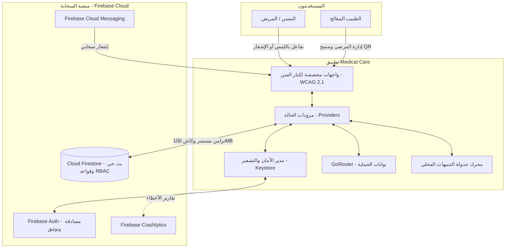

# 📑 الدليل التنفيذي السريع للمشروع (Executive Technical Summary)
## Smart Medication Management System for Elderly People
### نظام إدارة الأدوية الذكي والمتابعة الصحية لكبار السن (Medical Care App)

---

## 💡 نبذة تنفيذية وفكرة المشروع (Project Elevator Pitch)
**Medical Care App** هو منصة صحية رقمية ذكية متكاملة مصممة لسد الفجوة بين المرضى كبار السن وأطبائهم المعالجين. يهدف النظام إلى القضاء على مشكلة **"عدم الالتزام الدوائي" (Medication Non-Adherence)** التي تتسبب في ملايين حالات الانتكاس الصحي ودخول المستشفيات سنوياً، وذلك عبر توفير تذكير ذكي وتفاعلي بمواعيد الجرعات، وتتبع المؤشرات الحيوية (ضغط، سكر، وزن، حرارة)، وربط المسن مباشرة بطبيبه عبر مسح رمز QR سريع لمشاركة البيانات الحيوية لحظياً دون أي تعقيد تقني.

---

## 👥 حالات الاستخدام الرئيسية وفئات المستخدمين (Core Use Cases & Personas)

### 1. المسن ومقدم الرعاية (Patient & Caregiver Persona):
- **تذكير ذكي تفاعلي بالأدوية:** إشعارات فورية تمكن المسن من النقر المباشر على (تم التناول ✅ / تخطي ⏭️ / تأجيل ⏰) مباشرة من شاشة القفل أو مركز الإشعارات دون الحاجة لفتح التطبيق.
- **فترة سماح مرنة (30-Minute Grace Period):** تمييز الجرعات (قادمة، حان موعدها، في فترة السماح، فائتة) لتقليل الضغط النفسي على المسن.
- **تتبع المؤشرات الحيوية:** تسجيل قراءات ضغط الدم وسكر الدم والوزن مع إرشادات سريرية فورية ملونة (أخضر/طبيعي، أصفر/تحذيري، أحمر/خطر عاجل).
- **النتيجة الصحية الشاملة (Composite Health Score):** مؤشر ذكي من (0 إلى 100) يعكس الحالة العامة للمسن ويشجعه على نمط حياة صحي.
- **مشاركة سريعة عبر رمز QR:** توليد رمز QR فريد يتيح للطبيب أو أفراد الأسرة مسحه برمشة عين للاطلاع على التاريخ العلاجي.

### 2. الطبيب المعالج والعيادة (Doctor Persona):
- **إدارة علاقات المرضى (Patient CRM):** قائمة بجميع المرضى المرتبطين مع تصنيف درجات التزامهم العلاجي بدقة.
- **مراقبة المؤشرات الحيوية لحظياً (Live Telehealth Monitoring):** الاطلاع على الرسوم البيانية لتذبذب ضغط وسكر المريض عبر الزمن.
- **بطاقات الإنذار المبكر (Critical Alerts):** إشعار الطبيب تلقائياً عند تسجيل مريض لقراءة خطيرة (مثل ارتفاع مفاجئ في الضغط $\ge 180/120$ أو انخفاض حاد في السكر $< 54$).
- **تحليلات وتقارير أداء العيادة (Doctor Analytics & KPIs):** رسوم بيانية ومؤشرات توضح متوسط الالتزام العام لمرضى العيادة خلال 7 أو 30 أو 90 يوماً.

---

## 🛠️ مصفوفة التقنيات المستخدمة (Technology Stack Matrix)

| الطبقة التقنية (Tech Layer) | التقنية / المكتبة (Tool / Library) | دورها في المنظومة (Purpose & Role) |
| :--- | :--- | :--- |
| **واجهة التطبيق وإطار العمل** | **Flutter 3.x / Dart 3.x** | تطوير تطبيق هجين فائق السرعة يدعم منصتي Android و iOS بكود موحد. |
| **المعمارية البرمجية** | **Clean Architecture + Feature-First** | فصل منطق الأعمال عن الواجهات وقواعد البيانات لضمان أعلى معايير الصيانة والاختبار. |
| **إدارة الحالة (State)** | **Provider (v6.1.2) + ChangeNotifier** | إدارة تفاعلية خفيفة وفعالة وموثوقة لدورة حياة البيانات داخل الواجهات. |
| **التوجيه والتنقل (Routing)** | **GoRouter (v14.6.2)** | مسارات تنقل آمنة تعتمد على الحالة (Declarative Routing) مع بوابات حماية. |
| **المصادقة السحابية** | **Firebase Authentication (v5.3.3)** | إدارة دخول المستخدمين المشفر والتحقق الإجباري من البريد الإلكتروني. |
| **قاعدة البيانات السحابية** | **Cloud Firestore (v5.5.2)** | قاعدة بيانات NoSQL مع بث حي (Real-time Streams) وكاش محلي 100MB دون اتصال. |
| **التشفير وأمان العتاد** | **FlutterSecureStorage (Keystore/Keychain)** | حفظ بيانات الدخول والاعتمادات مشفرة بـ AES-256 بالاعتماد على رقاقة أمان الهاتف. |
| **فحص أمان الجهاز** | **Custom DeviceSecurityService** | رصد هواتف الـ Rooted والـ Jailbroken وتعطيل التخزين المؤقت لحماية الخصوصية. |
| **الإشعارات وجدولة المواعيد** | **Flutter Local Notifications + Timezone** | جدولة تذكيرات الأدوية الدقيقة مع معرّفات حتمية (Deterministic Hash IDs). |
| **الإشعارات السحابية** | **Firebase Cloud Messaging (FCM)** | استقبال التنبيهات السحابية الفورية من الأطباء وإشعارات الطوارئ. |
| **الرسوم البيانية والتحليلية** | **fl_chart (v0.68.0)** | تمثيل مسارات القراءات الحيوية ونسب الالتزام برسوم بيانية تفاعلية سلسة. |
| **مسح وتوليد الباركود** | **mobile_scanner + qr_flutter** | قراءة وتوليد رموز الاستجابة السريعة (QR) لإجراء الاقتران الفوري بين المريض والطبيب. |
| **دعم اللغات والترجمة** | **Flutter Localizations + intl** | دعم كامل وثنائي للغتين العربية (RTL) والإنجليزية (LTR). |
| **رصد الأعطال والاستقرار** | **Firebase Crashlytics + Analytics** | اصطياد الأخطاء الحرجة وغير الحرجة وتحليل تجربة الاستخدام فورياً في بيئة الإنتاج. |

---

## 🏛️ مخطط التدفق والترابط المعماري (High-Level Architecture Flow)



---

## ⚡ المزايا والابتكارات الهندسية الفريدة (Key Engineering Innovations)

1. **معالجة إجراءات الإشعار في الإقلاع البارد (Cold Start Action Handling):**
   حل مبتكر لمشكلة تفاعل المستخدم مع الإشعار والتطبيق مغلق تماماً؛ يتم احتجاز الإجراء في طابور انتظار مسبق (`Pending Actions Queue`) وإعادة بثه للمزودات فور اكتمال بناء الواجهة.
2. **منع التكرار بالأرقام البصمية (Action Idempotency):**
   حماية مخزون الدواء من الخصم المزدوج عند نقر المسن على زر التأكيد عدة مرات متتالية عبر كاش زمني مؤقت (TTL 5 Minutes).
3. **التشغيل دون إنترنت التام (Offline-First Resilience):**
   كاش سحابي محلي بسعة 100MB، مع فترة سماح 7 أيام للمصادقة في وضع عدم الاتصال (`OfflineAuthGate`) وشريط علوي تفاعلي ينبض بحالة الشبكة.
4. **تأمين البيانات الطبية بمعايير كبرى الشركات (Big Tech Security):**
   حظر تدريجي للمحاولات الفاشلة، كشف أجهزة الروت وكسر الحماية، وقواعد وصول صارمة ومقيدة بـ 342 سطراً في Firestore.
5. **معايير الوصولية والطباعة المقيدة (Accessibility for Elderly):**
   عناصر لمس عملاقة ($\ge 48\text{dp}$)، تباين بصري عالي، وتحجيم منضبط للنصوص حتى لا تتشوه الواجهة إذا رفع المسن حجم خط الهاتف من إعدادات الأندرويد أو الآيفون.

---

## 🚀 دليل التشغيل والتثبيت السريع (Quick Start & Setup Guide)

### المتطلبات الأساسية (Prerequisites):
- تثبيت **Flutter SDK** (الإصدار 3.22 فما فوق).
- تثبيت **Dart SDK** (الإصدار 3.0 فما فوق).
- بيئة تطوير متكاملة (**VS Code** أو **Android Studio**).
- حساب **Firebase** مهيأ بمشروع `medical_care_app`.
- هاتف فعلي أو محاكي (Android Emulator / iOS Simulator).

### خطوات التشغيل (Step-by-Step Setup):

1. **الانتقال لمجلد المشروع البرمجي:**
   ```bash
   cd develop
   ```

2. **تثبيت حزم ومكتبات المشروع:**
   ```bash
   flutter pub get
   ```

3. **توليد ملفات الترجمة والتوطين اللغوي:**
   ```bash
   flutter gen-l10n
   ```

4. **تشغيل فحص الأكواد للتأكد من سلامة البناء:**
   ```bash
   flutter analyze
   ```

5. **بدء تشغيل التطبيق في وضع التطوير (Debug Mode):**
   ```bash
   flutter run
   ```

6. **لبناء حزمة أندرويد نهائية (Release APK / Bundle):**
   ```bash
   flutter build apk --release
   ```

---

## 📈 الأثر المجتمعي والقيمة الطبية (Value Proposition)
- **إنقاذ الأرواح والحد من التسمم الدوائي:** تقليل حوادث نسيان الدواء أو تناول جرعات مضاعفة نتيجة ضعف الذاكرة.
- **تخفيف العبء على المستشفيات:** الكشف المبكر عن أزمات الضغط والسكر يمنع حدوث الجلطات والمضاعفات الطارئة.
- **طمأنة عائلات كبار السن:** توفير راحة بال تامة لذوي المسن من خلال إمكانية التحقق المستمر من التزامه العلاجي وصحته العامة عن بُعد.

---
**تم إعداد هذا الملخص التنفيذي السريع كدليل تعريفي شامل للمشروع، ومزاياه، وبنيته التقنية الحديثة.**
